# Classification of Breast Cancer Lesions in 3D Automated Breast Ultrasound

**[Project page](https://alinaderiparizi.com/abus-classification/) · [Code](https://github.com/mralinp/abus-classification) · [Roadmap](#roadmap) · [Results so far](#results-so-far)**

Automated 3D breast ultrasound (ABUS) images the whole breast in a single sweep, but reading the
resulting volumes is slow, and telling malignant lesions from benign ones remains hard.

This repository is a research reference for **studying, implementing and evaluating published ABUS
methods on TDSC-ABUS 2023**. We select relevant and influential papers, reconstruct their methods,
run experiments on a shared benchmark, and publish the evidence needed for other researchers to
understand, verify and extend the work.

Our current focus is paper reproduction and evaluation. Each study connects an implementation in
`abus_classification`, an explanatory notebook, Kaggle GPU kernels, stored results and a detailed
reproduction guide. Those records explain what we did, how and why, including assumptions,
differences from the paper, unexpected behavior and follow-up experiments. Original authors are
welcome to review the implementation and contribute corrections; review status is recorded explicitly.

**Phase 3** will study Laplace–Beltrami shape representations and their classification performance,
using the reproduced methods as baselines. Our previous paper [7] motivates that investigation;
its finalized source, including the CNN code, is currently awaited from the first author.

Start with the [research index](https://github.com/mralinp/abus-classification/blob/main/docs/papers.md) and [research workflow](https://github.com/mralinp/abus-classification/blob/main/docs/research-workflow.md).
The index distinguishes current reproductions, planned studies and historical thesis experiments.

The work is carried out at the Iran Image Processing Lab (IIPL) by Ali Naderiparizi and Sepideh Barekatrezaei,
under the supervision of Dr. Ehsan Kozegar and Dr. Mohsen Soryani (main supervisor). Code is released under
the MIT license.

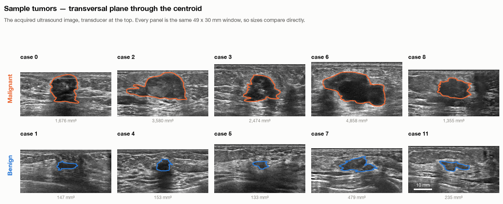

---

## Results so far

All results below use the **official TDSC-ABUS test split** (70 lesions: 40 malignant, 30 benign).
Published challenge scores are labeled separately from our evaluations. A completed run does not
imply original-author verification or an exact reproduction of the original protocol.
Always answering "malignant" scores 57.1% accuracy on it.

| Method | Features / model | Test AUC | Test accuracy | Notes |
| --- | --- | --- | --- | --- |
| Tan et al. 2012, reproduced here | 11 radiomic features, RBF SVM | **0.86** (95% CI 0.77–0.94) | **78.6%** | CV AUC 0.83 ± 0.03 |
| Tan et al. 2012 without spiculation, reproduced here | 8 features, RBF SVM | 0.79 | 75.7% | CV AUC 0.74 |
| Tan et al. 2013, reproduced here | 14 features, LDA | 0.82 | 72.9% | CV AUC 0.82 |
| Zhou et al. 2021, reproduced here | Multi-task V-Net, CMSVNetIter | 0.67 (95% CI 0.53–0.79) | 62.9% | mean of 3 seeds; Dice 0.73 |
| Wang et al. 2020, reproduced here | Multiview Inception-v3 (CNN A), official boxes | 0.755 (95% CI 0.63–0.86) | 65.7% | mean of 3 seeds; transverse view alone reaches 0.80 |
| Yu et al. 2024, reproduced here | ResNet34 on lesion crops, soft voting | 0.81 (mean of seeds 0.825, 95% CI 0.72–0.92) | 70.0% | 3 seeds; whole slices reach 0.75 |
| TDSC-ABUS challenge winner (T1, SZU) | 3D ResNet | 0.889 | 75.7% | reported in the challenge paper |

> **Comparing across rows.** The reproductions here compute features from the ground-truth lesion
> masks, and the CNN patches are centred on those masks. Challenge entries had to locate and segment lesions themselves, so their task was harder.
> Closing that gap — running every method on predicted segmentations as well — is part of Phase 2.

**What the Tan et al. reproductions show so far** (details in
[`1-tao2013.ipynb`](https://github.com/mralinp/abus-classification/blob/main/notebooks/1-tao2013.ipynb)):

- **Coronal spiculation replicates.** Tan's spiculation features score AUC 0.80–0.81 on their own,
  matching the 0.81–0.83 reported on their Nijmegen data, and removing them costs the classifier
  0.07 test AUC. They are not a proxy for lesion size.
- **Several classic ultrasound features do not transfer.** Posterior acoustic behavior falls to chance
  (AUC 0.50, against 0.80 in the paper), and the height-to-width ratio and margin contrast lose most of
  their signal.
- **Shape carries most of the signal on this data.** Among general radiomic features, boundary fractal
  dimension (AUC 0.75), surface area, compactness and sphericity (0.74) lead, while intensity features
  sit near chance — which motivates the shape-based approach in Phase 3.

| Tan's features on two lesions | ROC on the test split |
| --- | --- |
| 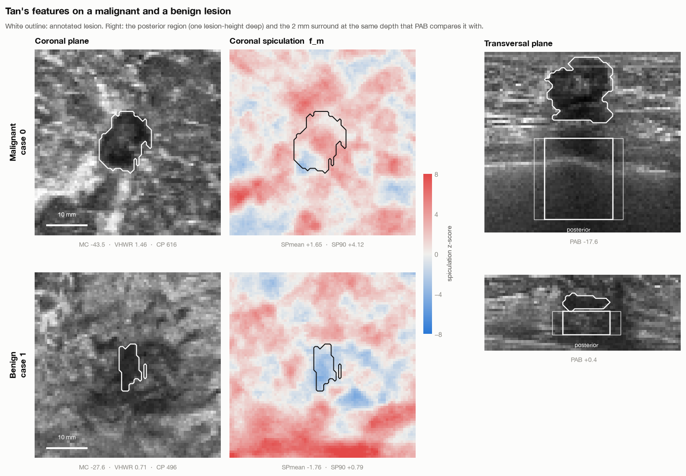 | 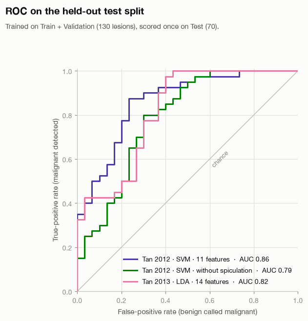 |

**Barekatrezaei et al. 2026 — awaiting finalized author source.** The first author's finalized
source, including the CNN implementation, is pending. Provisional comparisons are omitted from
this README while fidelity is unresolved. Existing runs, differences and diagnostics remain in the
[notebook](https://github.com/mralinp/abus-classification/blob/main/notebooks/2-barekatrezaei2026.ipynb) and
[reproduction record](https://github.com/mralinp/abus-classification/blob/main/docs/reproductions/barekatrezaei2026.md); they are not a finalized assessment
of the paper. See [#28](https://github.com/mralinp/abus-classification/issues/28).

**Zhou et al. 2021** (details in
[`3-zhou2021.ipynb`](https://github.com/mralinp/abus-classification/blob/main/notebooks/3-zhou2021.ipynb)):

- **Different data and evaluation.** The paper reports AUC 0.787, accuracy 74.1% and Dice 0.778 from four-fold
  cross-validation on private data. Our TDSC-ABUS evaluation gives AUC 0.67, accuracy 62.9% and Dice 0.73.
  These protocols do not establish a direct replication of the paper's score.
- **Refinement helps segmentation, as in the paper.** The paper's classification gain does not show here: on one seed,
  the full method scores AUC 0.65 against 0.74 without refinement, with overlapping confidence intervals.
- **The classification head under-fits.** Its loss barely falls during training and training AUC only reaches about
  0.75. The cause is not yet tested.

**Wang et al. 2020** (details in
[`4-wang2020.ipynb`](https://github.com/mralinp/abus-classification/blob/main/notebooks/4-wang2020.ipynb)):

- **Different data and evaluation.** The paper reports AUC 0.947 with five-fold cross-validation on private data;
  our TDSC-ABUS Test AUC is 0.755. The dataset and protocol difference limits conclusions about the original result.
- **The multiview gain does not show.** The transverse view alone scores highest (0.80), and ImageNet weights give no visible
  gain; all confidence intervals overlap.
- **Validation overstates the result.** Best validation AUC averages 0.94 for CNN A on 30 lesions, against 0.74 on test.

**Yu et al. 2024** (details in
[`6-yu2024.ipynb`](https://github.com/mralinp/abus-classification/blob/main/notebooks/6-yu2024.ipynb)):

- **Unresolved comparison on the paper's data and protocol.** The paper reports soft voting AUC 0.986 from five-fold
  cross-validation on the TDSC Train split; our reconstruction gives 0.85 under that split protocol. Several implementation
  details remain assumptions. Its voting rows list AUC equal to accuracy, and its hard voting sensitivity and specificity
  imply accuracy 0.937 rather than 0.907; these are questions for author clarification.
- **Soft voting helps only a little over hard voting.** It adds about 0.02 AUC, without a paired test yet.
- **Training memorises quickly.** Training accuracy reaches about 100%, by epoch 2 on whole slices. The likely cause is volumes
  being memorised; this is not yet tested.
- **Early stopping did not help, so the paper defaults stay the main result.** We added it because of that memorising, stopping on the
  official Validation split. Crops move from ensemble AUC 0.825 to 0.832, whole slices fall from 0.765 to 0.676, and no pretraining rises from 0.687
  to 0.697; all paired 95% intervals include zero. Five-fold CV also falls, from 0.846 to 0.796 on crops. Validation AUC reaches
  0.91–0.994 against 0.67–0.81 on Test, so 30 validation volumes are a poor guide.
- **Challenge benchmark, classification only:** crops rank 4 of 9 (Cls_Score 0.734) with defaults and 2 of 9 (0.844) with early stopping.
  AUC is close, and most of the gap is three test volumes at the 0.5 threshold. A second session with the same settings gave rank 3, so this rank is not stable. This method uses ground-truth masks, so it has no overall rank.

**Laplace–Beltrami invariance** (details in
[`lb-invariance.ipynb`](https://github.com/mralinp/abus-classification/blob/main/notebooks/lb-invariance.ipynb)):

- **The invariances hold.** Rigid motion, isometry and scale (λₖ·Area) are exact on meshes. Random rigid motions of re-voxelised lesions
  change λₖ·Area by about 0.2% on smoothed surfaces and 1% on staircase surfaces.
- **The eigenvalues in our previous work measure size.** They come from the cotangent matrix L without the mass matrix, and eig(L) ≈ λ·Area / n,
  with n the vertex count (ratio 0.99–1.00 here). The stored values rank lesions almost exactly by vertex count (Spearman −1.00 at k = 99), so they
  also depend on the voxel grid. In 29 of 200 lesions, an extra mesh piece shifts their indices.
- **Little signal remains in the low modes once size is removed.** On Train + Validation, cross-validated AUC is 0.59 for λₖ·Area with k = 1–20, 0.71 for
  volume and 0.72 for the stored values. Adding these modes to volume lowers it to 0.65. Higher modes and lighter smoothing are untested.

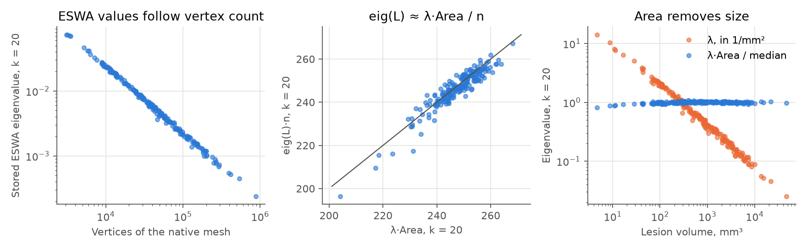

**What the Laplace–Beltrami spectrum determines** (details in
[`lb-spectrum-content.ipynb`](https://github.com/mralinp/abus-classification/blob/main/notebooks/lb-spectrum-content.ipynb)):

- **Area can be read from the spectrum, volume cannot.** Weyl's law recovers lesion area to about 4% from modes around k = 50–100. The Euler number comes back within about 0.1 on fine sphere and torus meshes, but too noisily on lesion meshes to count handles.
- **Kac's limit is real here.** An isometric dent changes volume but not the spectrum, and a Sunada pair of non-isometric surfaces shares its spectrum to 3e-15.
- **Area normalisation is not enough in practice.** At a fixed voxel size and smoothing width, λₖ·Area at high modes still follows volume (Spearman up to 0.96).
- **In a linear model, the spectrum adds nothing to volume on Train + Validation.** With volume removed, AUC is at most 0.49 on every surface up to k = 100. Tan's spiculation, which uses image gradients, keeps 0.69 under the same check. Sphericity also falls to about chance. Non-linear models and size-matched meshing are untested.

**Roundness and lobulation from the spectrum** (details in
[`lb-roundness.ipynb`](https://github.com/mralinp/abus-classification/blob/main/notebooks/lb-roundness.ipynb)):

- **Matching meshes to lesion size fixes the size leak.** Giving each lesion a grid and smoothing proportional to its size cuts the correlation of λₖ·Area with volume from up to 0.96 to at most 0.21.
- **Hersch's bound holds, and λ₁·Area / 8π mostly reads elongation.** No genus-0 lesion exceeds the bound; the median ratio is 0.61 and the largest 0.88. Its Spearman correlation with elongation is −0.69.
- **Lobes split eigenvalues by an exact rule, on near-round shapes only.** A lobe of even degree d first splits level d/2, within about 5% of the first-order prediction, and odd degrees split only at second order. Real lesions are far outside that range.
- **Little spectral signal remains beyond volume, even when sizes are matched.** On Train + Validation, CV AUC after removing volume is 0.57 for λ₁·Area and at most 0.55 for all-mode sets. Adding λ₁·Area to volume gives 0.72 against 0.71. A plain extent ratio does better: 0.63 after volume, 0.75 with it. Many comparisons were made on 130 lesions.

| Lobes and the levels they split | Real lesions by their distance from the round sphere |
| --- | --- |
| 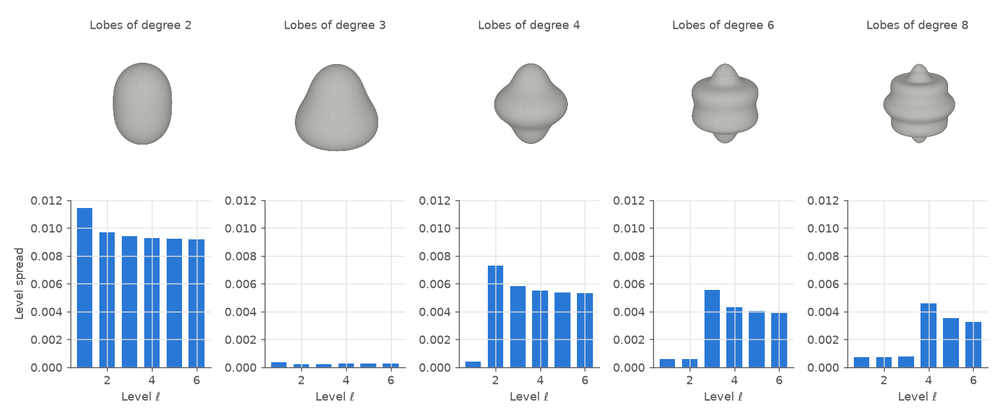 | 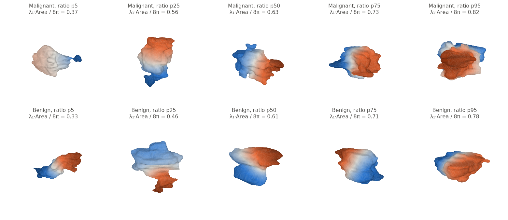 |

**Stability of the spectrum** (details in
[`lb-stability.ipynb`](https://github.com/mralinp/abus-classification/blob/main/notebooks/lb-stability.ipynb)):

- **Eigenvalues have a proved limit, with one exception.** The ratio of any eigenvalue to its deformed value is bounded by how much the surface's metric changes, for every mode. Necks escape it: a thin neck barely changes volume and strongly lowers λ₁.
- **Small percent changes hide low reliability.** High modes move only about 1% under 0.5 mm boundary noise, but lesions differ by about that much too. ICC at that noise is 0.81 at k = 1, 0.44 at k = 20 and 0.13 at k = 100, against 0.99 for volume.
- **On real predicted masks, a lesion's rank in the spectrum mostly disappears.** With Zhou 2021's masks (mean Dice about 0.73), Spearman between true and predicted is 0.92 for volume, 0.64 for elongation, 0.40 for λ₁·Area and about 0 from k = 20 up. Those patches are centred on the true lesion, so a full pipeline would not do better. The network also rounds shapes: median sphericity rises from 0.38 to 0.62, and 94% of predictions are rounder than their true mask.
- **Simulated noise does not explain the weak class signal.** AUC stays about flat up to 0.5 mm of noise. So instability is a separate limit, and the annotation error already in the true masks remains unmeasured.

| A real lesion under increasing boundary noise | True and predicted surfaces, Test lesions |
| --- | --- |
| 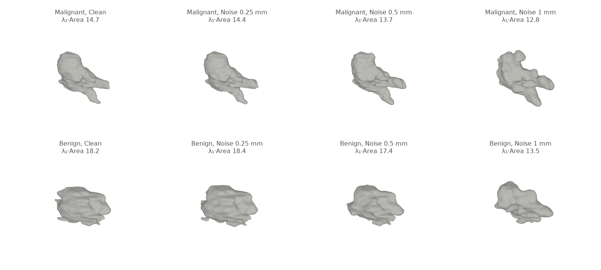 | 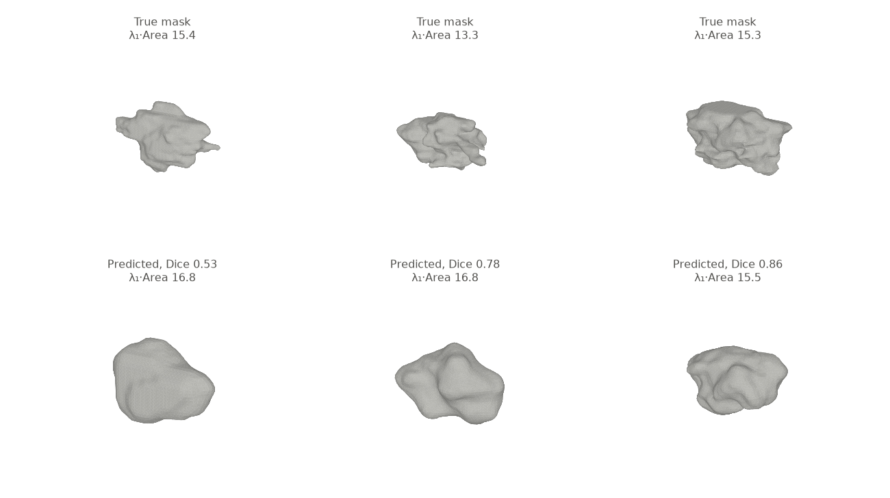 |

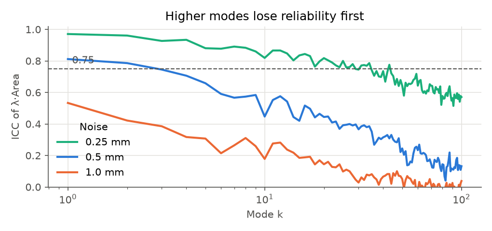

**Spherical harmonics and the spectrum** (details in
[`lb-spherical-harmonics.ipynb`](https://github.com/mralinp/abus-classification/blob/main/notebooks/lb-spherical-harmonics.ipynb)):

- **The two views connect exactly on near-round shapes.** A lobe of degree d appears at harmonic degrees d ± 1 and first splits eigenvalue level d/2.
- **Real lesions can be mapped.** All 200 map to the sphere conformally, 19 after topology correction, with almost no flipped triangles. The map is the one in Hersch's proof: its energy is within 5% of 8π, and λ₁·Area stays below it on every lesion. Thin parts shrink and reconstruct worst.
- **Harmonic power is more reliable than eigenvalues at fine scales.** At 0.5 mm noise, ICC is 0.70 at degree 10 (about mode 120) against 0.13 at k = 100. On predicted masks, rank is 0.48 at degree 10, where eigenvalues from k = 20 keep none. At coarse scales they are about equal. Topology correction may account for part of this.
- **Reliability does not bring class signal.** On Train + Validation, CV AUC after removing volume is at most 0.56 for harmonic features, against 0.70 for spiculation.

| Rebuilding real lesions from harmonics | Sphere maps of real lesions |
| --- | --- |
| 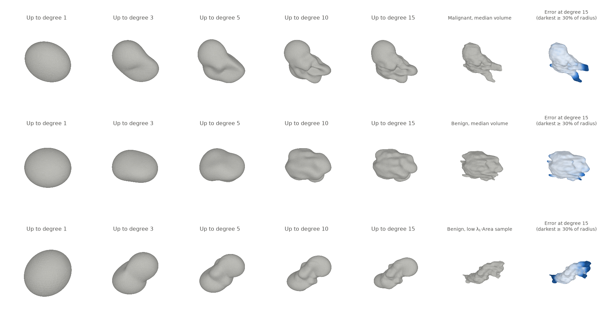 | 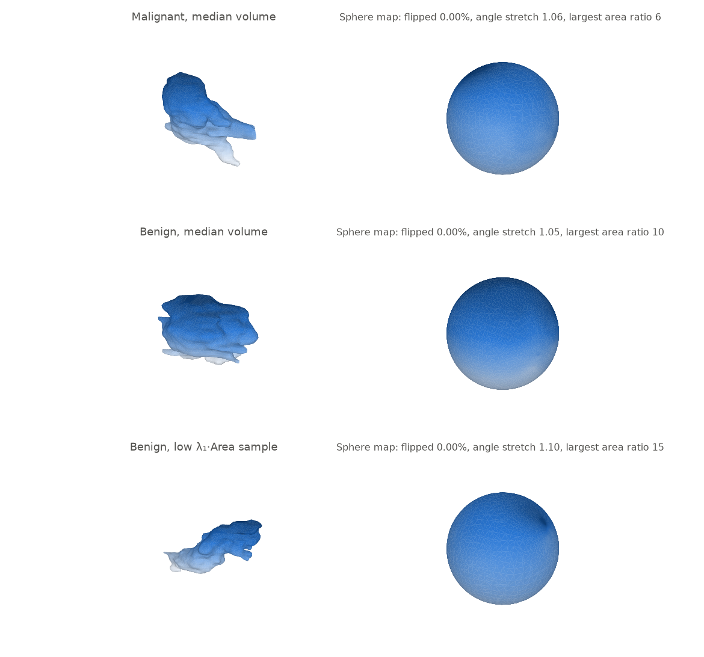 |

**Spectral descriptors as classifiers** (details in
[`lb-descriptors.ipynb`](https://github.com/mralinp/abus-classification/blob/main/notebooks/lb-descriptors.ipynb)):

- **Features using eigenfunctions show the first spectral signal beyond volume.** On Train + Validation, CV AUC after removing volume is 0.64 for the count of heat-kernel maxima ("tips", protrusions at a given scale) and for the WKS 95th percentile, against 0.44–0.47 for Shape-DNA. With volume, they reach about 0.77 against 0.71 for volume alone.
- **Not yet established.** The best gain over all 9 families beats shuffled features (p = 0.02), but each gain's 95% interval includes zero, and that test does not correct for earlier work on the same 130 lesions. Test has not been used.
- **Overlaps with spiculation.** Tips add only 0.015 on top of volume and Tan's spiculation (0.80), which remains the strongest feature here.
- **The means cannot help in principle.** Mean HKS is the heat trace and mean WKS is identically 1, so only their spread and maxima can add to the eigenvalues.

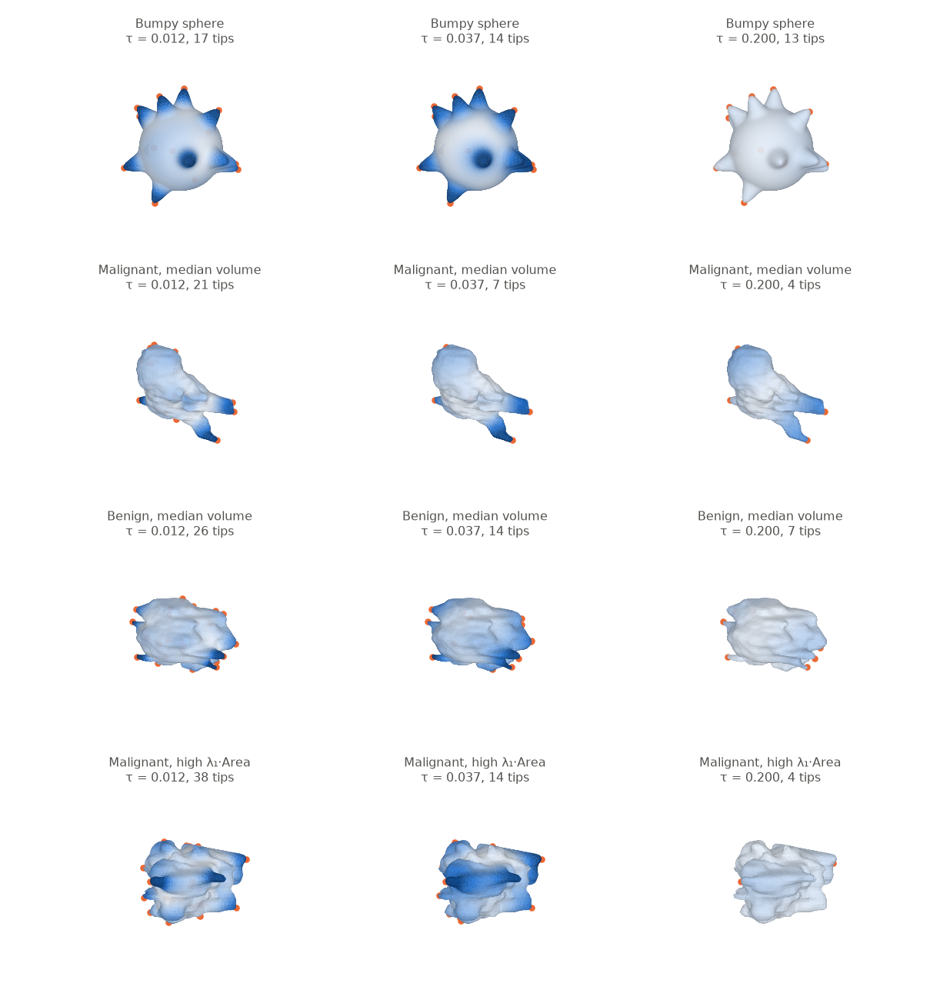

| Protrusions by class, and the gain against shuffled features |
| --- |
| 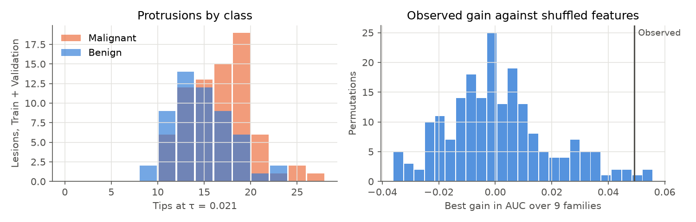 |

| Predicted and true tumors, Zhou et al. 2021 | Ablations against the paper |
| --- | --- |
| 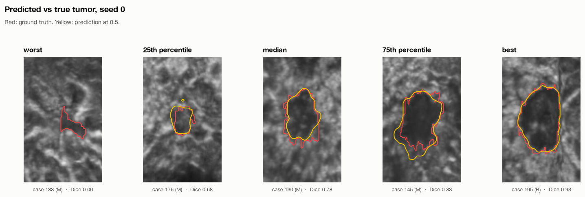 | 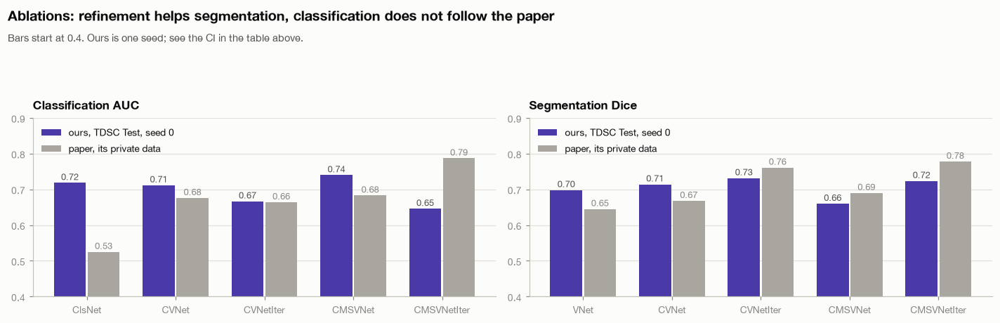 |

---

## Roadmap

Status: ✅ recorded work completed within its stated scope · 🔄 in progress · ⬜ planned.
These symbols do not indicate original-author verification; see the [research index](https://github.com/mralinp/abus-classification/blob/main/docs/papers.md).

### Phase 0 — Foundations ✅

| | Task | Where |
| --- | --- | --- |
| ✅ | Reproducible environment with [uv](https://docs.astral.sh/uv/) | `pyproject.toml`, `uv.lock` |
| ✅ | TDSC-ABUS data loading | [`tdsc-abus2023-pytorch`](https://github.com/mralinp/tdsc-abus2023-pytorch) |
| ✅ | Physical voxel spacing and ABUS plane geometry (transversal, coronal, sagittal) | `abus_classification/utils/spacing.py` |
| ✅ | Dataset statistics and visualization, in millimetres | [`0-visualization.ipynb`](https://github.com/mralinp/abus-classification/blob/main/notebooks/0-visualization.ipynb) |
| ✅ | Tested feature library (radiomic, Tan et al., spectral shape descriptors) | `abus_classification/features`, `test/` |

### Phase 1 — Reproduce classical radiomics ✅

| | Paper | Authors | Approach and PR |
| --- | --- | --- | --- |
| ✅ | *[Computer-aided lesion diagnosis in automated 3-D breast ultrasound using coronal spiculation](https://doi.org/10.1109/TMI.2012.2184549)* [1, 3] | Tan et al. 2012 | Coronal spiculation after the mammography stellate-lesion statistic [4], 11 features, SVM; AUC 0.86. [`1-tao2013.ipynb`](https://github.com/mralinp/abus-classification/blob/main/notebooks/1-tao2013.ipynb), PR [#21](https://github.com/mralinp/abus-classification/pull/21) |
| ✅ | *[Evaluation of the effect of computer-aided classification of benign and malignant lesions on reader performance in automated three-dimensional breast ultrasound](https://doi.org/10.1016/j.acra.2013.07.013)* [2, 3] | Tan et al. 2013 | 14 features, LDA; AUC 0.82. [`1-tao2013.ipynb`](https://github.com/mralinp/abus-classification/blob/main/notebooks/1-tao2013.ipynb), PR [#21](https://github.com/mralinp/abus-classification/pull/21) |

### Phase 2 — Reproduce the strongest published results 🔄

The shared target protocol fits Train + Validation (130 volumes) and evaluates the official Test split
(70), with malignant as the positive class, three seeds and AUC confidence intervals. Original-paper
protocols and variants are reported separately. For example, holding out Validation for early stopping
fits only Train (100); it must not be described as the same training protocol. Each volume's slices and patches stay
together when creating splits. Pairwise statistical comparisons and evaluation using
predicted segmentations remain planned where not explicitly reported.

Each study also reports the [challenge benchmark](https://github.com/mralinp/abus-classification/blob/main/notebooks/challenge-benchmark.ipynb) on the published leaderboard
(`abus_classification/challenge.py`). So far that covers classification only ([#34](https://github.com/mralinp/abus-classification/issues/34)).

| | Paper | Authors | Approach and PR |
| --- | --- | --- | --- |
| 🔄 | *[Breast mass classification in 3D ABUS based on Laplace-Beltrami spectra and dual path CNN](https://doi.org/10.1016/j.eswa.2025.129973)* [7], our previous work | Barekatrezaei et al. 2026 | Awaiting finalized source, including the CNN code, from the first author; provisional findings retained in the notebook and [reproduction record](https://github.com/mralinp/abus-classification/blob/main/docs/reproductions/barekatrezaei2026.md) ([#28](https://github.com/mralinp/abus-classification/issues/28)). [`2-barekatrezaei2026.ipynb`](https://github.com/mralinp/abus-classification/blob/main/notebooks/2-barekatrezaei2026.ipynb), PR [#27](https://github.com/mralinp/abus-classification/pull/27) |
| 🔄 | *[Tumor detection, segmentation and classification challenge on automated 3D breast ultrasound: the TDSC-ABUS challenge](https://arxiv.org/abs/2501.15588)* [5], team T1 (SZU) | Luo et al. 2025 | 3D ResNet, U-Net and anchor-free detector; in progress, implementation and Kaggle run under way ([#30](https://github.com/mralinp/abus-classification/issues/30)) |
| ⬜ | *[Tumor detection, segmentation and classification challenge on automated 3D breast ultrasound: the TDSC-ABUS challenge](https://arxiv.org/abs/2501.15588)* [5], team T2 (POSTECH) | Luo et al. 2025 | Multi-task residual nnU-Net; not started ([#31](https://github.com/mralinp/abus-classification/issues/31)) |
| ⬜ | *[Tumor detection, segmentation and classification challenge on automated 3D breast ultrasound: the TDSC-ABUS challenge](https://arxiv.org/abs/2501.15588)* [5], team T3 (HU) | Luo et al. 2025 | nnU-Net, nnDetection and patch-based 3D ResNet-18; not started ([#32](https://github.com/mralinp/abus-classification/issues/32)) |
| ⬜ | *[Tumor detection, segmentation and classification challenge on automated 3D breast ultrasound: the TDSC-ABUS challenge](https://arxiv.org/abs/2501.15588)* [5], team T4 (KTH) | Luo et al. 2025 | STU-Net and 2.5D DenseNet201 with voting; not started ([#33](https://github.com/mralinp/abus-classification/issues/33)) |
| ✅ | *[Multi-task learning for segmentation and classification of tumors in 3D automated breast ultrasound images](https://www.sciencedirect.com/science/article/abs/pii/S1361841520302826)* [6] | Zhou et al. 2021 | Multi-task V-Net: joint segmentation and classification; test AUC 0.67, Dice 0.73 (paper, on its own data: 0.787, 0.778), with ablations; patches centred on ground-truth masks. [`3-zhou2021.ipynb`](https://github.com/mralinp/abus-classification/blob/main/notebooks/3-zhou2021.ipynb), PR [#26](https://github.com/mralinp/abus-classification/pull/26) |
| ✅ | *[Three-dimensional automated breast ultrasound (ABUS) tumor classification using a 2D-input network: soft voting or hard voting?](https://doi.org/10.3390/app142411611)* [8] | Yu et al. 2024 | ResNet34 on 2D slices with hard and soft voting; test AUC 0.81 from lesion crops, 0.75 from whole slices (paper: 0.986, five-fold CV on Train; ours on that protocol: 0.85). Early stopping did not improve it; challenge classification rank 4 of 9. [`6-yu2024.ipynb`](https://github.com/mralinp/abus-classification/blob/main/notebooks/6-yu2024.ipynb), PR [#43](https://github.com/mralinp/abus-classification/pull/43) |
| ✅ | *[Breast cancer classification in automated breast ultrasound using multiview convolutional neural network with transfer learning](https://doi.org/10.1016/j.ultrasmedbio.2020.01.001)* | Wang et al. 2020 | Multiview Inception-v3; test AUC 0.755 (paper, on its own data: 0.947), with view ablations; uses the official boxes. [`4-wang2020.ipynb`](https://github.com/mralinp/abus-classification/blob/main/notebooks/4-wang2020.ipynb), PR [#38](https://github.com/mralinp/abus-classification/pull/38) |
| 🔄 | *[Fully automatic classification of automated breast ultrasound (ABUS) imaging according to BI-RADS using a deep convolutional neural network](https://doi.org/10.1007/s00330-022-08558-0)* | Hejduk et al. 2022 | Three step-wise 2D CNNs and a sliding window over slices; running on Kaggle, no PR yet |
| ⬜ | Unified comparison table and statistical tests across all reproduced methods | — | — |

### Phase 3 — Mathematical foundations of Laplace–Beltrami shape representation 🔄

Our previous work [7] motivates studying Laplace–Beltrami spectra of lesion surfaces. Foundational
invariance work has begun alongside the benchmark studies; full descriptor classification comparisons
remain pending. This phase investigates which
properties of a tumor's shape the spectrum provably captures, which it cannot, how stable it is under
the imperfections of real ultrasound segmentations, and how it relates to spherical harmonic
decompositions. Every claim is paired with an empirical check on TDSC-ABUS, and the theory is used to
derive better-founded descriptors.

| | Step | Notes |
| --- | --- | --- |
| ✅ | Watertight lesion surfaces | `utils.mesh.lesion_mesh`: meshes in millimetres; padding and no morphological closing keep all 200 surfaces closed |
| ✅ | Discrete Laplace–Beltrami operator | Cotangent scheme with lumped mass matrix, verified against the analytic spectrum of the unit sphere; convergence to the smooth operator depends on mesh conditions studied in [15, 16] |
| ✅ | Invariance | Proved and verified for rigid motion, isometry and scale (λₖ·Area). On re-voxelised lesions it holds to 0.2–1%. [`lb-invariance.ipynb`](https://github.com/mralinp/abus-classification/blob/main/notebooks/lb-invariance.ipynb) |
| ✅ | What the spectrum determines | Surface area from Weyl's law [17]; area and Euler characteristic from the heat-trace expansion [18]; and its limits, the question posed by Kac [19]. Area is recoverable to about 4% on lesions; the Euler number only on fine meshes. [`lb-spectrum-content.ipynb`](https://github.com/mralinp/abus-classification/blob/main/notebooks/lb-spectrum-content.ipynb) |
| ✅ | Roundness and irregularity | Hersch's inequality, λ₁·Area ≤ 8π on genus-0 surfaces with equality only for the round sphere [20], makes the first eigenvalue a provable measure of departure from roundness; relate higher eigenvalues to lobulation and spiculation. Hersch's bound holds on every genus-0 lesion; a selection rule ties lobes to eigenvalue splitting on near-round shapes only. [`lb-roundness.ipynb`](https://github.com/mralinp/abus-classification/blob/main/notebooks/lb-roundness.ipynb) |
| ✅ | Stability | Bound how far eigenvalues move under surface perturbation, mesh resolution, voxel anisotropy and segmentation error, and measure it on TDSC-ABUS. Eigenvalues are bounded by metric change except at necks; on predicted masks a lesion's spectral rank mostly disappears. [`lb-stability.ipynb`](https://github.com/mralinp/abus-classification/blob/main/notebooks/lb-stability.ipynb) |
| ✅ | Spectral descriptors | Shape-DNA [9], heat kernel signature [10], wave kernel signature [11], global point signature [12]. Eigenfunction-based summaries show the first signal beyond volume, not yet established. [`lb-descriptors.ipynb`](https://github.com/mralinp/abus-classification/blob/main/notebooks/lb-descriptors.ipynb) |
| ✅ | Spherical harmonics | Spherical harmonics are the Laplace–Beltrami eigenfunctions of the sphere, so a spherical harmonic decomposition [13, 14] and the lesion's own spectrum are two views of one framework; it needs genus-0 surfaces, so voxel-derived surfaces with handles require topology correction first. All 200 lesions map to the sphere, 19 after topology correction; harmonic power is more reliable than high eigenvalues. [`lb-spherical-harmonics.ipynb`](https://github.com/mralinp/abus-classification/blob/main/notebooks/lb-spherical-harmonics.ipynb) |
| ⬜ | Theory-driven descriptors | Design descriptors from the results above, fuse them with spiculation, intensity and CNN features, and evaluate under the Phase 2 protocol with ablations |

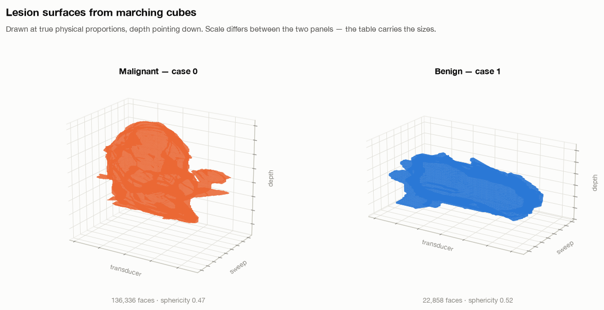

#### The feature sets in 3D

[`lb-features-3d.ipynb`](https://github.com/mralinp/abus-classification/blob/main/notebooks/lb-features-3d.ipynb) shows what each one measures, on reference shapes and real TDSC-ABUS lesions chosen by volume percentile. These illustrate one lesion per class and are not evidence of a class difference.

**The real surfaces.** Staircase meshes from binary masks, and the same lesions after light smoothing.

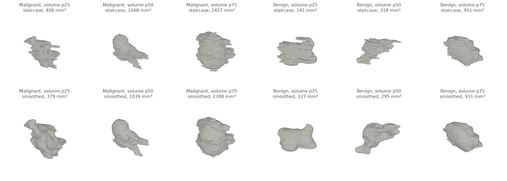

**Shape-DNA, the eigenvalues:** the pitches a surface vibrates at, a global description that ignores pose and, multiplied by area, size. Shape appears as the departure from Weyl's line.

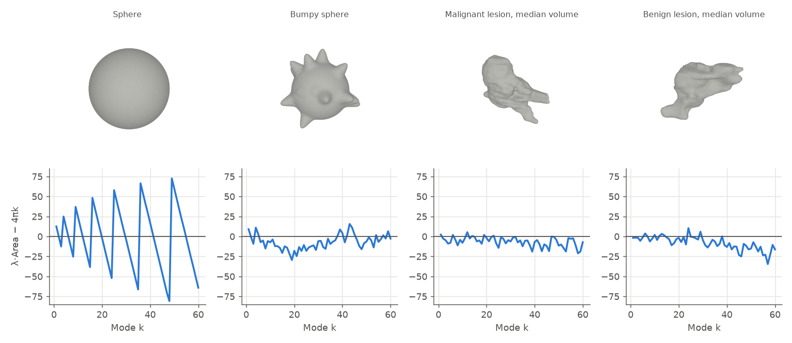

**Eigenfunctions:** the vibration patterns. Low modes split a shape along its long extents; higher modes make finer patches.

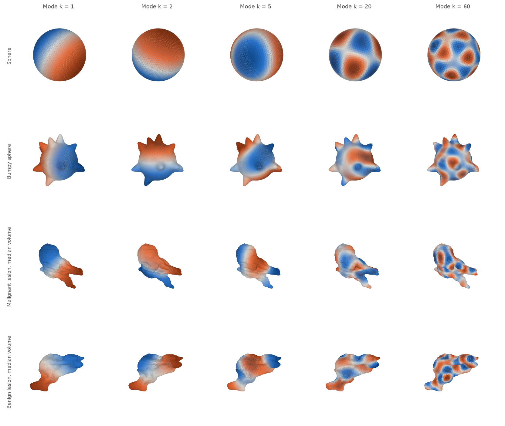

**Heat diffusion:** heat placed at one point spreads over time, and how much returns underlies the heat trace.

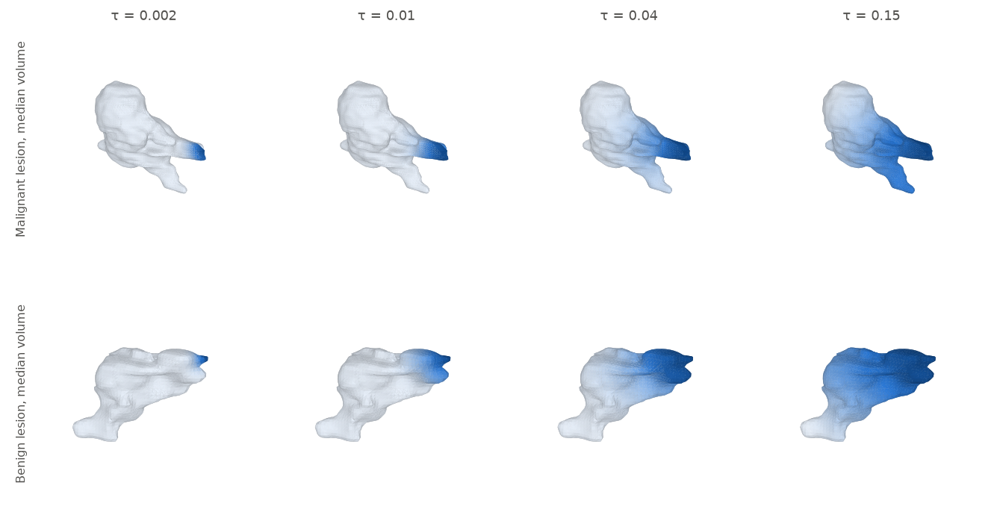

**Heat kernel signature:** how much heat stays at each point. It stays longest on tips, so dark regions mark protrusions at the scale set by time.

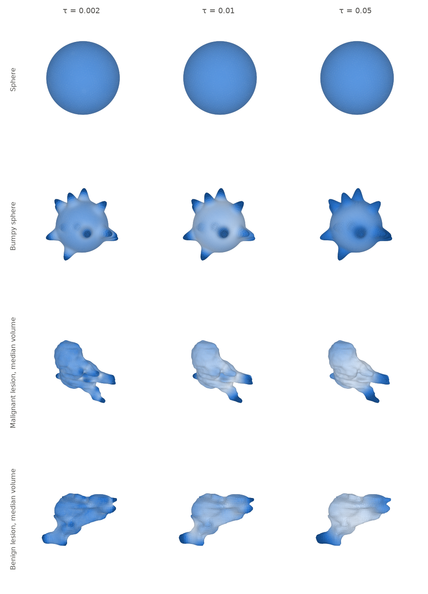

**Wave kernel signature:** a band-pass version that isolates one range of modes.

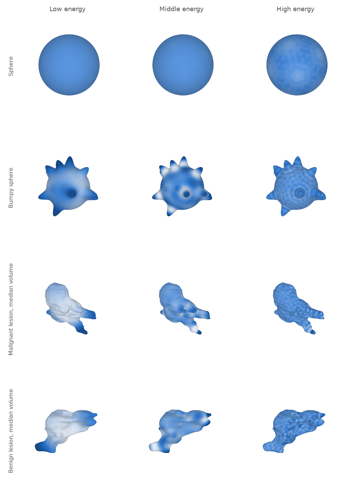

**Global point signature:** a new embedding where distance reflects how the surface connects, not how it sits in space.

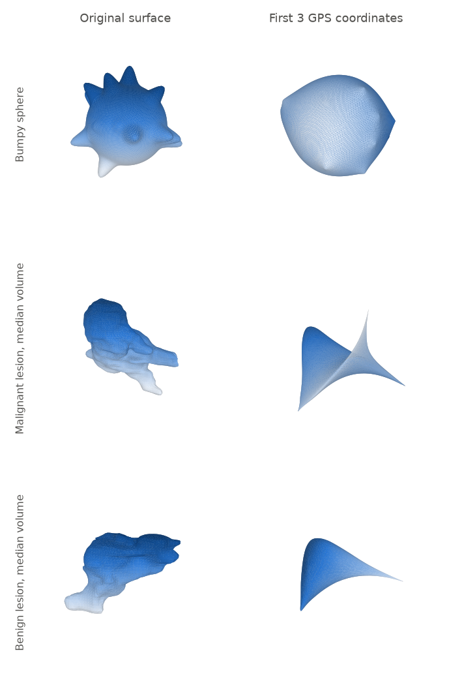

**Spherical harmonics:** the sphere's own vibration patterns, used as a basis for rebuilding a surface mapped onto the sphere. Unlike the spectrum, they see how a surface sits in space.

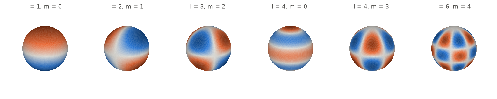

**What it cannot see:** an isometric dent keeps the spectrum and changes the volume, and Sunada surfaces share a spectrum without being isometric.

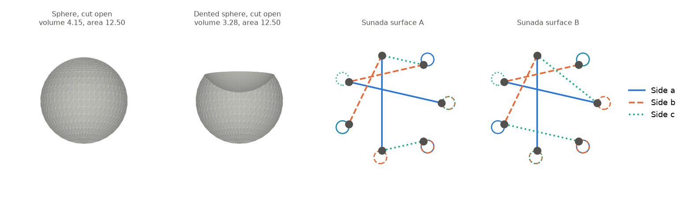

### Phase 4 — Paper ⬜

| | Task |
| --- | --- |
| ⬜ | Final experiments, ablations and statistical comparison |
| ⬜ | Figures and manuscript |
| ⬜ | Release of code, trained models and evaluation scripts |

---

## Datasets

### TDSC-ABUS 2023

The public dataset of the [TDSC-ABUS 2023 challenge](https://tdsc-abus2023.grand-challenge.org/): 200
ABUS volumes acquired with a GE Invenia ABUS at Harbin Medical University Cancer Hospital, each with a
voxel-level tumor mask and a malignant/benign label.

| Split | Volumes | Malignant | Benign |
| --- | --- | --- | --- |
| Train | 100 | 58 | 42 |
| Validation | 30 | 17 | 13 |
| Test | 70 | 40 | 30 |
| **Total** | **200** | **115** | **85** |

Access requires a signed data use agreement; see the
[dataset page](https://tdsc-abus2023.grand-challenge.org/Dataset/).

**Voxels are not cubes.** The volumes are 843–865 × 546–682 × 270–354 voxels at 0.200 mm along the
transducer, 0.073 mm in depth and 0.476 mm between slices, and the NRRD files do not record this. All
features and figures here use physical units; measured in voxels, lesions appear up to five times
thinner along one axis than they are.

### IIPL-3D-ABUS

A private dataset of 70 ABUS volumes (55 malignant, 15 benign) collected at the Iran Image Processing
Lab and segmented under the supervision of two expert radiologists. It cannot be shared; for enquiries,
contact <me@alinaderiparizi.com>.

---

## Getting started

### Install

The project is managed with [uv](https://docs.astral.sh/uv/), which also installs a suitable Python:

```bash
curl -LsSf https://astral.sh/uv/install.sh | sh
git clone https://github.com/mralinp/abus-classification.git
cd abus-classification
uv sync
```

`uv.lock` currently resolves for macOS, where PyTorch uses the Apple Silicon `mps` backend. To run on
Linux with CUDA, remove `environments` under `[tool.uv]` in `pyproject.toml` and run `uv lock`.

### Data

Place the TDSC-ABUS splits under `data/tdsc/`:

```text
data/tdsc/
├── Train/        DATA/, MASK/, labels.csv, bbx_labels.csv
├── Validation/
└── Test/
```

```python
from tdsc_abus2023_pytorch import TDSC, DataSplits
from abus_classification.features import tan

dataset = TDSC(path="data/tdsc", split=DataSplits.TRAIN, download=True)
volume, mask, label, bbox = dataset[0]          # label: 0 = malignant, 1 = benign

features = tan.extract_tan_features(volume, mask)   # millimetre-aware, uses TDSC-ABUS spacing
```

Passing `download=True` makes the dataset automatically downloaded if its not present on the system.

### Run

```bash
uv run pytest test/features_tests test/utils_tests test/papers_tests   # library and paper tests
uv run jupyter lab                                   # after: uv add --group notebooks jupyterlab
```

Training runs on Kaggle GPU kernels (see [`kaggle/README.md`](https://github.com/mralinp/abus-classification/blob/main/kaggle/README.md)). Notebooks load the stored
outputs in `results/`, so they open without a long run. To run a reproduction yourself:

```bash
uv run python -m abus_classification.papers.zhou2021 --epochs 100
```

### Google Colab

```python
!git clone https://github.com/mralinp/abus-classification.git
%cd abus-classification
!pip install -e .
```

---

## Repository layout

| Path | Contents |
| --- | --- |
| `abus_classification/papers/` | Paper implementations (`barekatrezaei2026`, `zhou2021`, `wang2020`, `yu2024`); completion and source verification vary |
| `abus_classification/protocol.py` | Shared evaluation protocol: device, metrics, folds, bootstrap CI |
| `abus_classification/lb_invariance.py`, `lb_spectrum_content.py`, `lb_roundness.py`, `lb_stability.py`, `lb_spharm.py`, `lb_descriptors.py` | Laplace–Beltrami experiments on TDSC-ABUS lesions: invariance, what the spectrum determines, roundness, stability, spherical harmonics, spectral descriptors |
| `abus_classification/challenge.py` | TDSC-ABUS 2023 challenge evaluation (Dice, HD, ACC, AUC, FROC) and published leaderboard |
| `abus_classification/data/` | Lesion cache: patches, radiomic and Laplace–Beltrami features per volume |
| `abus_classification/features/tan/` | Tan et al. (2012, 2013) features, including coronal spiculation |
| `abus_classification/features/radiology/` | General radiomic features in physical units |
| `abus_classification/features/shape_descriptor/` | Laplace–Beltrami operator, spectral signatures, boundary signatures, spherical harmonics |
| `abus_classification/features/texture/` | Grey-level co-occurrence texture features |
| `abus_classification/models/` | U-Net, V-Net, SE-FNet, multi-task V-Net |
| `abus_classification/utils/` | Meshing, voxel spacing and resampling, image utilities |
| `notebooks/` | Current study notebooks and historical thesis experiments; see the [research index](https://github.com/mralinp/abus-classification/blob/main/docs/papers.md) |
| `docs/papers.md` | Study index: implementations, notebooks, kernels, results and documentation gaps |
| `docs/reproductions/` | Detailed records of what ran, how, why, deviations and remaining verification |
| `kaggle/` | Kaggle kernel scripts for the training runs |
| `results/` | Stored results of those runs, per paper |
| `test/` | Unit tests |

---

## References

1. T. Tan, B. Platel, H. Huisman, C. I. Sánchez, R. Mus, N. Karssemeijer. Computer-aided lesion diagnosis in automated 3-D breast ultrasound using coronal spiculation. *IEEE Transactions on Medical Imaging* 31(5):1034–1042, 2012. [doi:10.1109/TMI.2012.2184549](https://doi.org/10.1109/TMI.2012.2184549)
2. T. Tan, B. Platel, T. Twellmann, G. van Schie, R. Mus, A. Grivegnée, R. M. Mann, N. Karssemeijer. Evaluation of the effect of computer-aided classification of benign and malignant lesions on reader performance in automated three-dimensional breast ultrasound. *Academic Radiology* 20(11):1381–1388, 2013. [doi:10.1016/j.acra.2013.07.013](https://doi.org/10.1016/j.acra.2013.07.013)
3. T. Tan. *Automated 3D breast ultrasound image analysis.* PhD thesis, Radboud University Nijmegen, 2014. [pdf](https://repository.ubn.ru.nl/bitstream/handle/2066/121931/121931.pdf)
4. N. Karssemeijer, G. M. te Brake. Detection of stellate distortions in mammograms. *IEEE Transactions on Medical Imaging* 15(5):611–619, 1996. [doi:10.1109/42.538938](https://doi.org/10.1109/42.538938)
5. G. Luo, M. Xu, H. Chen, X. Liang, X. Tao, D. Ni, et al. Tumor detection, segmentation and classification challenge on automated 3D breast ultrasound: the TDSC-ABUS challenge. arXiv:2501.15588, 2025. [arXiv](https://arxiv.org/abs/2501.15588)
6. Y. Zhou, H. Chen, Y. Li, Q. Liu, X. Xu, S. Wang, D. Shen, P.-T. Yap. Multi-task learning for segmentation and classification of tumors in 3D automated breast ultrasound images. *Medical Image Analysis* 70:101918, 2021. [ScienceDirect](https://www.sciencedirect.com/science/article/abs/pii/S1361841520302826)
7. S. Barekatrezaei, A. Naderiparizi, E. Kozegar, J. Ghofrani, M. Soryani. Breast mass classification in 3D ABUS based on Laplace-Beltrami spectra and dual path CNN. *Expert Systems with Applications* 299:129973, 2026. [doi:10.1016/j.eswa.2025.129973](https://doi.org/10.1016/j.eswa.2025.129973)
8. S. Yu, X. Liang, S. Zhao, Y. Xie, Q. Sun. Three-dimensional automated breast ultrasound (ABUS) tumor classification using a 2D-input network: soft voting or hard voting? *Applied Sciences* 14(24):11611, 2024. [doi:10.3390/app142411611](https://doi.org/10.3390/app142411611)
9. M. Reuter, F.-E. Wolter, N. Peinecke. Laplace–Beltrami spectra as "Shape-DNA" of surfaces and solids. *Computer-Aided Design* 38(4):342–366, 2006. [doi:10.1016/j.cad.2005.10.011](https://doi.org/10.1016/j.cad.2005.10.011)
10. J. Sun, M. Ovsjanikov, L. Guibas. A concise and provably informative multi-scale signature based on heat diffusion. *Computer Graphics Forum* 28(5):1383–1392, 2009. [doi:10.1111/j.1467-8659.2009.01515.x](https://doi.org/10.1111/j.1467-8659.2009.01515.x)
11. M. Aubry, U. Schlickewei, D. Cremers. The wave kernel signature: a quantum mechanical approach to shape analysis. *IEEE International Conference on Computer Vision Workshops*, 2011.
12. R. M. Rustamov. Laplace-Beltrami eigenfunctions for deformation invariant shape representation. *Eurographics Symposium on Geometry Processing*, 2007.
13. C. Brechbühler, G. Gerig, O. Kübler. Parametrization of closed surfaces for 3-D shape description. *Computer Vision and Image Understanding* 61(2):154–170, 1995. [doi:10.1006/cviu.1995.1013](https://doi.org/10.1006/cviu.1995.1013)
14. M. Kazhdan, T. Funkhouser, S. Rusinkiewicz. Rotation invariant spherical harmonic representation of 3D shape descriptors. *Eurographics Symposium on Geometry Processing*, 2003.
15. K. Hildebrandt, K. Polthier, M. Wardetzky. On the convergence of metric and geometric properties of polyhedral surfaces. *Geometriae Dedicata* 123(1):89–112, 2006. [doi:10.1007/s10711-006-9109-5](https://doi.org/10.1007/s10711-006-9109-5)
16. A. I. Bobenko, B. A. Springborn. A discrete Laplace–Beltrami operator for simplicial surfaces. *Discrete & Computational Geometry* 38(4):740–756, 2007. [doi:10.1007/s00454-007-9006-1](https://doi.org/10.1007/s00454-007-9006-1)
17. H. Weyl. Das asymptotische Verteilungsgesetz der Eigenwerte linearer partieller Differentialgleichungen. *Mathematische Annalen* 71(4):441–479, 1912. [doi:10.1007/BF01456804](https://doi.org/10.1007/BF01456804)
18. H. P. McKean, I. M. Singer. Curvature and the eigenvalues of the Laplacian. *Journal of Differential Geometry* 1(1–2):43–69, 1967. [doi:10.4310/jdg/1214427880](https://doi.org/10.4310/jdg/1214427880)
19. M. Kac. Can one hear the shape of a drum? *The American Mathematical Monthly* 73(4):1–23, 1966. [doi:10.1080/00029890.1966.11970915](https://doi.org/10.1080/00029890.1966.11970915)
20. J. Hersch. Quatre propriétés isopérimétriques de membranes sphériques homogènes. *Comptes Rendus de l'Académie des Sciences de Paris* 270:1645–1648, 1970.
21. M. Karpukhin, N. Nadirashvili, A. V. Penskoi, I. Polterovich. An isoperimetric inequality for Laplace eigenvalues on the sphere. *Journal of Differential Geometry* 118(2):313–333, 2021. [doi:10.4310/jdg/1622743142](https://doi.org/10.4310/jdg/1622743142)
22. J. Dodziuk. Eigenvalues of the Laplacian on forms. *Proceedings of the American Mathematical Society* 85(3):437–443, 1982. [doi:10.1090/S0002-9939-1982-0656119-2](https://doi.org/10.1090/S0002-9939-1982-0656119-2)
23. M. Kazhdan, J. Solomon, M. Ben-Chen. Can mean-curvature flow be modified to be non-singular? *Computer Graphics Forum* 31(5):1745–1754, 2012. [doi:10.1111/j.1467-8659.2012.03179.x](https://doi.org/10.1111/j.1467-8659.2012.03179.x)

---

## Citation

A paper is in preparation. Until then, please cite this repository:

```bibtex
@misc{naderiparizi_abus_classification,
  author       = {Ali Naderiparizi and Sepideh Barekatrezaei and Ehsan Kozegar and Mohsen Soryani},
  title        = {Classification of Breast Cancer Lesions in 3D Automated Breast Ultrasound},
  year         = {2026},
  howpublished = {\url{https://github.com/mralinp/abus-classification}}
}
```

## License and contact

Code: [MIT License](https://github.com/mralinp/abus-classification/blob/main/LICENSE). The TDSC-ABUS data is subject to the challenge's data use agreement.
Questions and collaboration: <me@alinaderiparizi.com>
